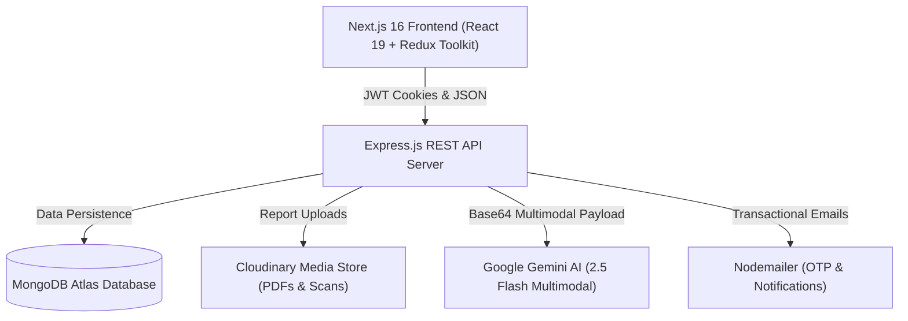

# HealthMate AI 🩺✨
### *Intelligent Medical Diagnostics & Clinical Vitals Tracking Companion*


**HealthMate AI** is a full-stack MERN healthcare application engineered to bridge the gap between complex diagnostic medical reports and patient comprehension. By harnessing the multimodal capabilities of **Google Gemini AI (2.5 Flash)**, HealthMate enables users to upload lab reports, pathology tests, or radiology scans (PDF/images) and receive instant, plain-English and conversational bilingual (Hindi / Hinglish) clinical summaries, flagged abnormalities, and personalized health questions for doctor consultations.

---

## 🌟 Key Highlights & Features

- 📑 **Multimodal Report Intelligence**:
  - Securely upload lab reports, blood panels, and clinical scans in PDF or image format.
  - Powered by Gemini 2.5 Flash to extract clinical markers (e.g. Hemoglobin, Fasting Blood Sugar, Lipid Profile, etc.).
  - Automatic medical validation: rejects non-medical files and validates authentic health documents.

- 🌐 **Bilingual Natural Language Explanations**:
  - Delivers summaries in two intuitive formats:
    - **English**: Concise, patient-friendly medical explanation.
    - **Hindi / Hinglish**: Conversational Romanized breakdown (*e.g., "Aapka hemoglobin thoda kam hai, jabki blood sugar normal range mein hai"*).
  - Removes medical jargon and anxiety from interpreting lab results.

- 📊 **Dynamic Vitals & Biomarkers Tracking**:
  - Log, monitor, and visualize daily health parameters: Blood Pressure, Fasting & Post-prandial Sugar, Weight, and customized notes.
  - Interactive charts and visual status badges (Normal, Low, High).

- 🔒 **Enterprise-Grade Authentication & Security**:
  - Dual-token JWT authentication flow with rotating Refresh Tokens and short-lived Access Tokens.
  - HTTP-only secure cookie storage to prevent XSS attacks.
  - Email OTP verification for account signup and password recovery using Nodemailer & Handlebars.

- 🎨 **Modern Responsive UI / UX**:
  - Built with Next.js 16 (App Router), React 19, and Tailwind CSS.
  - Polished glassmorphism aesthetics, dynamic SVG ECG animations, dark/light theme support, and micro-interactions.

---

## 🏗️ System Architecture



---

## 💻 Tech Stack

### Frontend:
- **Framework**: Next.js 16 (App Router, Turbopack)
- **Language**: TypeScript 5
- **UI Library**: React 19, Tailwind CSS v4, Lucide Icons, Radix UI Primitives
- **State Management**: Redux Toolkit & React-Redux
- **HTTP Client**: Axios with automated token refresh interceptors
- **Alerts & Modals**: SweetAlert2 & React Hot Toast

### Backend:
- **Runtime & Server**: Node.js & Express.js
- **Database**: MongoDB with Mongoose ODM
- **AI Engine**: Google Gemini API (`@google/genai`)
- **Authentication**: JSON Web Tokens (`jsonwebtoken`), `bcrypt` hashing, `cookie-parser`
- **File Management**: Multer, Cloudinary (`multer-storage-cloudinary`)
- **Email Engine**: Nodemailer with Handlebars (`hbs`) templates

---

## 🚀 Getting Started Locally

### 1. Clone & Setup
```bash
git clone https://github.com/shishu-37-bit/HealthMate-Ai-Integration.git
cd HealthMate-Ai-Integration
```

### 2. Configure Environment Variables

#### Backend (`backend/.env`):
```env
PORT=5000
CLIENT_URL=http://localhost:3000
MONGO_URL=mongodb://127.0.0.1:27017/healthmate
ACCESS_TOKEN_SECRET=your_jwt_access_secret
REFRESH_TOKEN_SECRET=your_jwt_refresh_secret
HASH_PASS=10
GEMINI_API_KEY=your_gemini_api_key
```

#### Frontend (`frontend/.env.local`):
```env
NEXT_PUBLIC_API_URL=http://localhost:5000
```

### 3. Install Dependencies & Run

#### Run Backend:
```bash
cd backend
npm install
npm run dev
# Server running at http://localhost:5000
```

#### Run Frontend:
```bash
cd frontend
npm install
npm run dev
# Web application live at http://localhost:3000
```

---

## 👨‍💻 Developer & Author

**Shivam Shukla**
- GitHub: [@shishu-37-bit](https://github.com/shishu-37-bit)
- Email: [shivamshukla.amity@gmail.com](mailto:shivamshukla.amity@gmail.com)

---

## 📄 License
This project is licensed under the [MIT License](LICENSE).
